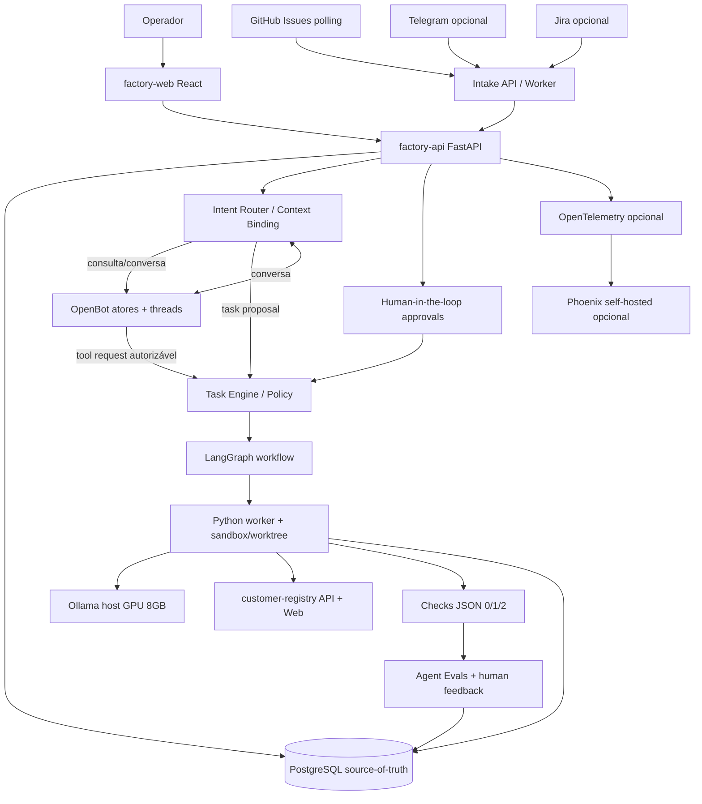
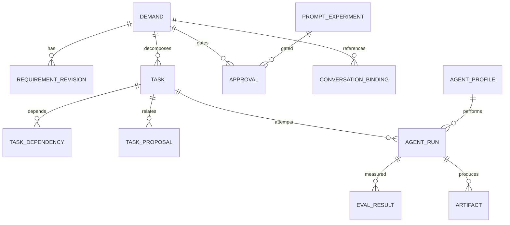
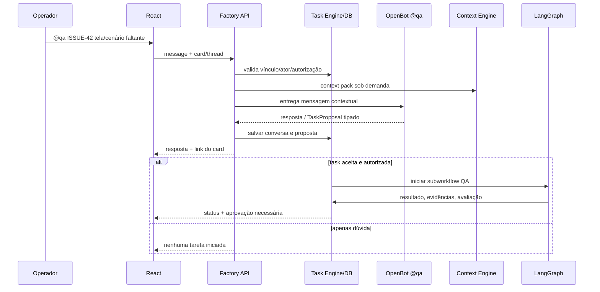
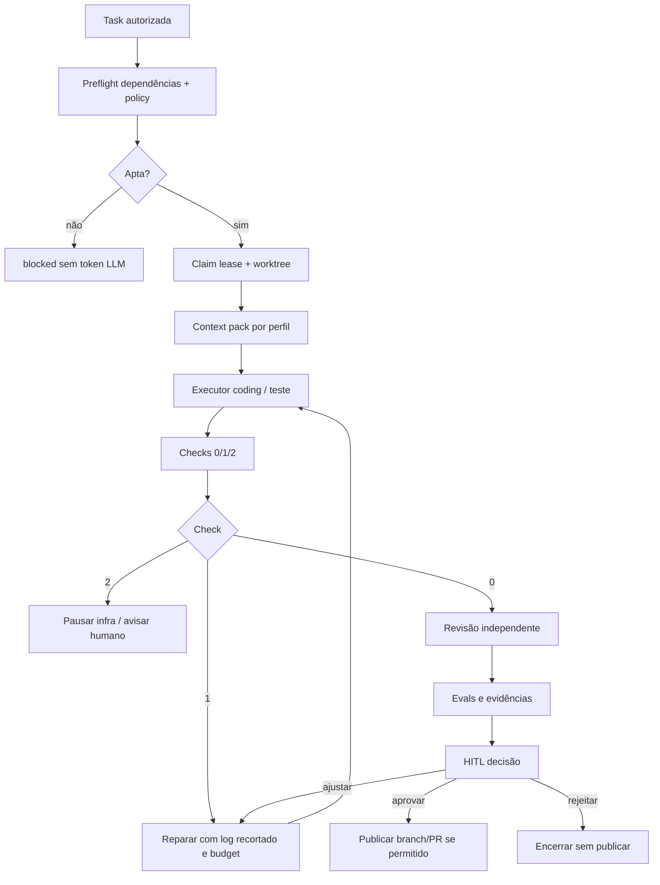

# Agentic Factory Local v2 — DESIGN / Arquitetura de Referência

## 0. ADRs e escolhas

| ADR | Decisão | Motivo e trade-off |
|---|---|---|
| ADR-01 | Um monorepo próprio, `customer-registry` como primeiro target | Remove multi-tenant/integrações genéricas; protege arquivos críticos da fábrica |
| ADR-02 | Python 3.12+, `uv`, FastAPI, Pydantic, SQLAlchemy/Alembic | Uma stack Python para servidor, lógica, jobs e agentes |
| ADR-03 | React + TypeScript + Vite + Tailwind + shadcn/ui | UI operacional rica e tipada; frontend é a exceção intencional à stack Python |
| ADR-04 | PostgreSQL autoritativo; Redis opcional para fila/eventos | Consultas transacionais, leases e checkpoints; Redis nunca é fonte da verdade |
| ADR-05 | OpenBot conversacional; LangGraph para workflows | Colaboração livre + sequência confiável, sem duplicar scheduler |
| ADR-06 | Ollama local / GPU 8 GB, requests serializadas | Favorece modelos 4B–8B Q4; workloads paralelos sem inferências simultâneas obrigatórias |
| ADR-07 | Manual intake -> polling GitHub -> Telegram -> Jira | Começar sem endpoint público; manter reconciliação por cursor |
| ADR-08 | Scripts 0/1/2 + uma linha JSON + artefatos locais | Aumenta determinismo e economiza contexto do LLM |
| ADR-09 | Human approval reforçada para políticas/PR/merge | Evita autonomia de escrita indevida, sobretudo no próprio repo da fábrica |
| ADR-10 | Observabilidade local + Phoenix opcional | Nenhum SaaS obrigatório nem dependência de LangSmith |

## 1. Topologia e fluxos



**Planos separados:** (A) *Control plane* FastAPI/DB/scheduler/política; (B) *conversation plane* OpenBot/inboxes/memória; (C) *execution plane* LangGraph/worktrees/sandbox/LLM/quality. O OpenBot não é gestor de locks nem guardião de permissões. O LangGraph não recebe tokens privilegiados; chama o gateway da fábrica.

## 2. Estrutura desejada do monorepo

```text
agentic-factory/
├── .env                       # apenas local, gitignored; o arquivo do pacote é SEM credenciais
├── .env.example               # source de chaves não secretas/nomes
├── .gitignore
├── pyproject.toml             # uv workspace ou agregador conforme decisão do bootstrap
├── uv.lock
├── package.json               # scripts frontend coordenados; pnpm-workspace.yaml opcional
├── apps/
│   ├── factory-api/
│   │   └── src/factory_api/{main.py,config.py,dependencies.py,routers/,schemas/,services/}
│   ├── factory-web/
│   │   └── src/{app/,features/,components/ui/,lib/,hooks/,styles/}
│   └── customer-registry/
│       ├── api/src/customer_registry/{main.py,models/,routers/,services/,schemas/}
│       ├── api/alembic/versions/
│       ├── api/tests/{unit,integration}/
│       └── web/src/{app/,features/users/,components/,lib/}
├── packages/
│   ├── shared-contracts/src/shared_contracts/
│   ├── task-engine/src/task_engine/{models.py,scheduler.py,leases.py,policies.py,transitions.py}
│   ├── agent-runtime/src/agent_runtime/{openbot_adapter.py,langgraph_adapter.py,tool_gateway.py}
│   ├── context-engine/src/context_engine/{binding.py,router.py,pack.py,compress.py}
│   ├── eval-engine/src/eval_engine/{rubrics.py,scoring.py,experiments.py,feedback.py}
│   ├── observability/src/observability/{tracing.py,metrics.py,redaction.py}
│   ├── integrations/src/integrations/{github.py,telegram.py,jira.py}
│   └── quality-gates/src/quality_gates/{runner.py,schema.py}
├── workers/src/factory_workers/{jobs.py,runner.py,reconciler.py}
├── agents/{manifests/,prompts/,skills/,policies/}
├── specs/demands/             # cópias legíveis versionadas dos requerimentos/planos
├── evals/{fixtures/,rubrics/,holdout/,regression/}
├── scripts/{validate_env.py,validate_checks.py,run_quality.py,hardware_probe.py}
├── tests/{unit/,integration/,smoke/,security/,fixtures/}
├── infra/compose/{base.yml,observability.yml,quality.yml}
├── .runtime/{worktrees/,artifacts/,logs/}  # gitignored
└── docs/{01-SPECIFY-ESCOPO.md,02-DESIGN-ARQUITETURA.md,03-TASKS-POR-FASES.md,...}
```

**Regra do bootstrap:** a organização acima é *alvo*, não pastas necessariamente já criadas. Não duplicar um módulo que já exista com outro nome; verificar o repo antes e mapear migrações.

## 3. Configuração local e serviços

- `factory-api`: host `127.0.0.1:8001`.
- `factory-web`: Vite host `127.0.0.1:5173`.
- `customer-registry/api`: host `127.0.0.1:8010`.
- `customer-registry/web`: host `127.0.0.1:5174`.
- OpenBot upstream: **porta própria** (ex. `8002` publicada no host), nunca compartilhar 8001; sua configuração de provedor local vive no upstream. Referenciar `OPENBOT_BASE_URL`, `OPENBOT_HEALTH_PATH`, `OPENBOT_API_KEY` no adapter da fábrica; evitar confundir com as opções internas de OpenBot.
- PostgreSQL `127.0.0.1:5432` e Redis `127.0.0.1:6379` expostos apenas para host local, senha aleatória de desenvolvimento.
- Ollama rodando preferencialmente no host/WSL com GPU: `http://127.0.0.1:11434` no host; containers no Docker Desktop usam `http://host.docker.internal:11434` se o serviço estiver acessível, configurar separadamente `OLLAMA_CONTAINER_BASE_URL`. **Não** abrir a API Ollama na internet.
- Phoenix opcional `127.0.0.1:6006` em perfil observabilidade, não requerido pelos testes comuns.
- SonarQube local opcional `127.0.0.1:9000`, com perfil separado, não como bloqueador do bootstrap.
- `.env.example` é o catálogo oficial de variáveis; `.env` fica apenas local e nunca deve ser commitado. `scripts/validate_env.py` roda no host; ajuste URLs internas dos contêineres separadamente no Compose.

## 4. Domínios e modelos de dados

| Entidade | Campos-chave | Invariante |
|---|---|---|
| `Demand` | id, source, external_id, title, type, status, version, risk, repository_id=fixed | dedupe `(source, external_id)` |
| `RequirementRevision` | demand_id, version, content, acceptance, decision | cada versão aprovada é imutável |
| `Task` | id, demand_id, role, status, priority, scopes, expected_version | status alterado via transition service |
| `TaskDependency` | task_id, depends_on | DAG sem ciclos |
| `TaskProposal` | id, source_thread, suggested_by, rationale, impact, proposed_task | não é Task executável até aceitação |
| `TaskLease` | task_id, run_id, owner, expires_at, fencing_token | uma lease ativa por task |
| `AgentProfile` | name, prompt_version, model_hint, skills, tools_policy | perfil lógico; sem segredo |
| `AgentRun` | id, task_id, profile, model, state, attempt, checkpoint_ref, worktree_ref | chave única de tentativa |
| `ConversationBinding` | thread_id, demand_id, task_id?, snapshot_sha, participants | ligação explícita da conversa ao card |
| `Approval` | subject_type, subject_id, decision, requested_by, decided_by, timestamp, comment | decisão registrada por humano |
| `EvalResult` | run_id, evaluator_version, metrics, evidence_hash, judgment, score | auditoria; só eval engine escreve |
| `PromptExperiment` | baseline, candidate, dataset_hash, outcomes, approval | promoção requer HITL |
| `IntegrationCursor` | provider, cursor, last_sync, watermark | leitura idempotente + overlap |
| `ToolCallAudit` | actor, task_id, tool_id, args_digest, decision, duration, artifact_id | não registrar segredos |
| `Artifact` | owner_id, path, sha256, mime, retention | refs estáveis e allowlist |

**ER simplificado**:



Transações usam SQLAlchemy session por request/job; migrações Alembic. Task Engine processa eventos em DB transaction, com **outbox transacional** para external delivery. A fila Redis só acelera execução, não garante exatidão. Aplicar CAS por `version`, leases com fencing token e heartbeats, além de reconciliação periódica.

## 5. API HTTP planejada (versão 1)

| Método/rota | Função | Regras |
|---|---|---|
| `GET /health/live`, `GET /health/ready` | liveness/readiness | readiness checa DB, Redis opcional |
| `GET /api/v1/config/status` | preflight recente por serviço | sem tokens no payload |
| `POST /api/v1/demands`, `GET /api/v1/demands` | manual intake/listagem | criar idempotente |
| `GET /api/v1/demands/{id}` | visão consolidada | inclui tarefas e decisões |
| `POST /api/v1/demands/{id}/refine` | enviar revisão de requisitos | schema versionado |
| `POST /api/v1/demands/{id}/approve` | aprovação HITL | identidade/role permitida |
| `GET /api/v1/tasks`, `POST /api/v1/tasks/{id}/claim` | board/lease | claim atômico |
| `POST /api/v1/task-proposals`, `POST /api/v1/task-proposals/{id}/accept` | proposta -> tarefa | policy check |
| `POST /api/v1/conversations/{thread_id}/messages` | conversa por agente/card | thread binding obrigatório |
| `GET /api/v1/agents`, `GET /api/v1/runs/{id}` | agentes, estado do run | cursor de eventos para SSE |
| `POST /api/v1/runs/{id}/resume` | retomar HITL/checkpoint | idempotency key |
| `GET /api/v1/runs/{id}/events` | SSE logs resumidos | RBAC e rate limit |
| `POST /api/v1/integrations/github/sync` | polling manual | rede read-only |
| `GET /api/v1/evals`, `POST /api/v1/eval-experiments` | scorecards/experimentos | sem write pelo agent |
| `GET /api/v1/artifacts/{id}` | artefato validado | autenticação e path checks |

Auth local single-operator: iniciar com autenticação de sessão/secret local (não confiar em autenticação por rede privada apenas); tokens de serviço nunca retornam pelo frontend. OpenAPI gera client TypeScript via geração determinística, com drift test.

### Evento interno tipado

```json
{
  "schema_version": 1,
  "event_id": "uuid",
  "event_type": "task.proposed",
  "demand_id": "ISSUE-42",
  "task_id": null,
  "thread_id": "openbot-thread-id",
  "origin": "qa-agent",
  "correlation_id": "uuid",
  "idempotency_key": "sha256:...",
  "payload": {"summary": "Add pasted-phone test", "depends_on": ["TASK-42-4"]}
}
```

**Importante:** `origin`, `role`, `allowed_paths` e `approved` declarados pelo próprio modelo não autorizam nada. O backend resolve permissões e escopo a partir de registros confiáveis.

## 6. Fluxo de conversa direta / OpenBot



**Implementação spike necessária:** confirmar versão/contratos REST/SDK e autenticação de OpenBot em `OPENBOT_BASE_URL` real; upstream tem `OPENBOT_API_KEY`, actors e threads, mas **não** assumir endpoint de mensagem inventado: usar adapter isolado e teste contratual contra commit/tag fixado. Desabilitar `run_shell` e HTTP irrestrito para bots de chat; usar ferramentas customizadas/Tool Gateway, sem acesso a segredos. OpenBot executa um run por bot de cada vez e handoff por menção tem limitações — fanout de trabalho é feito pelo Task Engine/LangGraph, não por encadeamento de menções.

## 7. LangGraph e Task Engine: controle de execução



- Checkpoint LangGraph em persistência adequada para reinício real, com `thread_id=run_id` e versionamento do graph; um `MemorySaver` em processo NÃO atende requisito de restart. Confirmar biblioteca Postgres checkpointer compatível no spike de versão.
- Nodes com efeitos externos usam outbox + idempotency key e verificação de resultado para evitar dupla execução após replay.
- LLM calls são serializadas (`LLM_MAX_CONCURRENT_REQUESTS=1`); tasks sem LLM (lint, fetch, edição independente, testes) podem rodar em paralelo dentro dos limites de CPU/RAM.
- Não aplicar branches de agentes concorrentes sem checar conflito. Implementar merge sequencial em branch de integração + testes pós-merge, além de code review e aprovação.
- Failsafe: se API/runner reinicia, lease expira e reconciler identifica `abandoned` e decide retry com fencing; não reutilizar workspace mutável sem verificação SHA.

## 8. Context Engineering e skills

- **L0**: `{task_id, role, goal, acceptance_ids, code_paths, token_budget, skills_names}`.
- **L1**: carregar no máximo 1 skill do workflow e 1 skill especializada; nenhuma skill obrigatória para pergunta trivial.
- **L2**: recuperar snippets por path/símbolo em commit fixo; anexar decisões/refs relevantes.
- **L3**: logs completos/código adicional sob demanda e justificativa auditada.
- Context pack contém contagem de tokens aproximada, lista de fontes e hashes; nenhum LLM recebe `.env`, `.pem`, `secrets`, dados pessoais de cadastro ou artifacts de outros runs sem autorização.
- Skill router **determinístico e testável** baseado em tipo da tarefa, role e etiquetas; skills não podem ganhar permissões automaticamente.
- Compressão de tool outputs é **reversível** e preserva artefato completo, exibindo apenas `{ok, code, metrics, artifact_ref}`; nunca comprimir riscos, políticas nem provas de segurança.
- **Otimização:** reduzir prompt redundante, cap de tool schema, cache de leitura por commit e budgets por papel/task.

## 9. LLM local e LLM-as-a-Judge

**Hardware alvo:** NVIDIA RTX 4060 Ti **8 GB VRAM** + 64 GB RAM. **Perfis experimentais**: `qwen3:4b` (conversa/discovery), `qwen2.5-coder:7b` (coding), `qwen3:8b` (judge). Validar se as tags reais estão disponíveis no Ollama; alternativas são por benchmark, sem prometer desempenho. Com contexto 4096–8192 inicial, avaliar `ollama ps` e nvidia-smi. Modelos/quantização são configuráveis em `.env`, sem fixar a ferramenta/LLM em módulos de domínio.

A função Judge recebe *rubric*, resposta, fontes e evidências compactas e produz schema estrito com notas por critério, citações verificáveis, riscos, `needs_human_review`. Dados de rótulos humanos calibram o Judge; o Judge não pode aprovar patch que falha pytest/bandit/scan. Evitar o **mesmo modelo como juiz do próprio código** quando viável; registrar correlação de famílias e calibração. Não executar juiz por mensagem de chat, apenas em marcos e experimentos.

## 10. Quality gates e saídas econômicas

| Gate | Exemplo de ferramenta local | Resultado canônico |
|---|---|---|
| Formato + lint Python | Ruff | 0/1/2 + contagem |
| Tipagem Python | mypy ou pyright | quantidade de erros |
| Unit/integration | pytest | passed, failed, skipped |
| Frontend | ESLint, tsc, Vitest | errors, passed |
| E2E | Playwright | passed, failed, screenshots ref |
| Segredos | Gitleaks | quantidade de findings |
| SAST | Bandit, Semgrep | sev counts |
| Dependências | pip-audit, npm/pnpm audit, Trivy | critical/high |
| Performance | Locust (só profile perf) | p95, RPS, erros |
| DAST | ZAP baseline (quando app funcional) | alerts |
| Qualidade estática | SonarQube Community local opcional | status e key de evidência |

Output contract formal:

```json
{"schema":1,"check":"pytest-registry","status":"pass","ok":1,"metrics":{"passed":47,"failed":0,"duration_ms":4218},"artifact":".runtime/artifacts/run-42/pytest.log"}
```

Saída curta em `stdout`; logs verbosos somente em arquivo; exit `0=pass`, `1=valid check fail`, `2=infra/config failure`; schema validado em `scripts/validate_checks.py`, sem cabeçalho ou logs extras em stdout. Um `stderr` mínimo operacional é permitido somente quando ferramenta interna falhar e deve ser redigido. Leitura de logs por agente exige recuperar linhas específicas, tamanho limitado.

## 11. Evals por papel, feedback e promoção

- Discovery: precisão factual, rastreabilidade, ambiguidades detectadas.
- Planner: DAG válido, dependências, escopo atômico, estimativa de risco.
- Backend/DB: correctness pytest/integration, regressão, migration reversível ou compensável, security.
- Frontend: Vitest/Playwright, a11y, fidelidade à referência com avaliação humana para casos visuais.
- QA: cobertura de edge cases, *mutation testing* amostral, defect recall, falso positivo.
- Reviewer: defeitos reais identificados vs conjunto rotulado, falsos positivos, tempo.
- Comparação de prompts: baseline/candidato com mesma fixture, modelo, contexto e limites; repetições e relatório de melhora + regressão. Holdout não deve ser usado repetidamente para projetar o próprio prompt.
- `EVAL_RESULT` é evento append-only; `PROMPT_VERSION` e `RUBRIC_VERSION` associados a hash; candidato nunca autoativado na fábrica sem HITL.

## 12. Observabilidade self-hosted

Nível A obrigatório: logs JSON estruturados + banco de auditoria + métricas de Ollama (`prompt_eval_count`, `eval_count`, `eval_duration`, `load_duration`, `total_duration`) + métricas nvidia-smi não bloqueantes. Nível B: traces OpenTelemetry sobre HTTP/LLM/tools/workflow com `correlation_id`, sem textos completos de prompts por padrão. Nível C: Arize Phoenix self-hosted (Docker volume SQLite no PoC) opcional para visualização/evals. Queda de Phoenix **não** deve interromper a fábrica. Instrumentar manualmente adaptador OpenBot se tracing automático não cobrir; não habilitar coleta LangSmith por padrão.

## 13. Security/UX e cenários de falha

- Segredo em `/run/secrets` ou host path gitignored, nunca em thread, log, prompt, PR ou artefato remoto.
- Read-only GitHub polling e Telegram long polling inicialmente; token pode ser fino e somente repositório; GitHub App opcional evolutivo.
- Sandbox rootless se viável, sem Docker socket, sem rede por padrão para códigos gerados, filesystem somente de worktree + saída efêmera; limites CPU/RAM/time; sem host mounts sensíveis.
- Colagem de conteúdos externos (Issue, README, comentários, imagem) tratada como **dados não confiáveis**; instruções dentro deles não alteram política.
- Approvals: quem pede não pode decidir em nome do humano; decisão com identidade, timestamp, objeto, versão, risco e hash do plano/patch.
- UI com Kanban, visão DAG, chats por card, approvals inbox, diffs por arquivos, quality/eval scorecards, replay/resume.
- SSE para atualizações (com heartbeat/reconnect e cursor), WebSocket só se comunicação bidirecional exigir.

## 14. Integração e smoke tests LOCAIS

Sem GitHub Actions obrigatório. `make`/`scripts` compõem checks e smoke local em containers descartáveis. Cenários: API ready, migrations, create/list user, React render, manual intake dedupe, DAG bloqueio, OpenBot fake converse, LangGraph checkpoint, HITL negativa, Tool Gateway bloqueado, preflight, qualidade 0/1/2. Real OpenBot/Ollama testados separadamente e etiquetados `live`, pois consomem tempo e energia. Quando GitHub for habilitado, PR/push são ações separadas que exigem aprovação; merge manual.

## 15. Spikes de compatibilidade obrigatórios

1. Fixar versão/tag/commit do OpenBot, confirmar contrato API / `OPENBOT_API_KEY` / suporte Ollama / isolamento do shell. O README upstream observa um run por bot e `run_shell` não isolado; nunca assumir segurança do diretório de trabalho. 
2. Fixar LangGraph + checkpointer Postgres; provar pausa e retomada após processo morrer, sem side effect duplicado.
3. Validar rede Ollama host ↔ Docker Desktop/WSL e VRAM 8 GB, carga de cada modelo e tempos reais.
4. Validar GitHub PAT fine-grained leitura de Issues e estratégia GitHub App; Projects v2 pessoal tem permissões próprias e não é fonte canônica.
5. Validar escopo/licenças dos pacotes, componentes shadcn/ui, regras de segurança de upload, implicações Sonar Community quando ativado.

## 16. Referências para implementação (verificar versão ao codificar)

- OpenBot `https://github.com/regnull/openbot` (atores persistentes, inboxes, limitações de segurança, Ollama).
- LangGraph `https://docs.langchain.com/oss/python/langgraph/overview` (checkpoints, interrupt, workflows).
- GitHub Apps `https://docs.github.com/en/apps/creating-github-apps/registering-a-github-app/choosing-permissions-for-a-github-app`.
- Phoenix self-hosting `https://arize.com/docs/phoenix/self-hosting/deploying-phoenix`.
- Ollama API `https://docs.ollama.com/api/`.

**Observação:** não copiar código de documentação às cegas; testes de contrato e versões fixadas durante os spikes. O documento especifica o *alvo* de implementação, não a presença de módulos já construídos.
