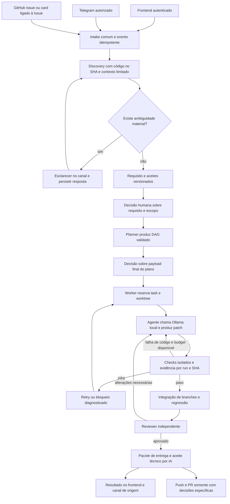

# Plano de conclusão operacional e validação ponta a ponta

> Decisão vigente de entrega: `assisted_delivery_policy` no backlog permite Codex
> assistido com bundle/hash/escopo aprovados, gates e review independente.
> Referências abaixo à geração LLM descrevem o objetivo de autonomia; não anulam
> a entrega assistida autorizada. FAC-135 foi aceita nesse modo; restam 10 atividades.

Plano original: 2026-10-24. **Escopo alvo; status atual no [roteiro de fechamento](10-FECHAMENTO-DAS-12-PENDENCIAS.md).** Complementa 01–07 e preserva os invariantes de local-first, repositório próprio, Task Engine autoritativo e HITL. A melhoria em `melhoria/08-...` é outro módulo, opt-in.

> **Revisão de fechamento em 2026-10-28:** por pedido explícito do operador, o critério
> para as oito últimas atividades foi reduzido a resultados locais verificáveis e
> evidência proporcional. O roteiro [10](10-FECHAMENTO-DAS-12-PENDENCIAS.md) e o
> backlog são as fontes atuais. Os itens estão `done` no escopo local reduzido; isso
> não representa aceite global, piloto de produção ou receipt AI/HMAC. Exigências mais
> amplas abaixo são objetivo original, não bloqueio do fechamento já autorizado.

Extensão de pesquisa: [09-EVALS-RUBRICAS-E-HARNESS](09-EVALS-RUBRICAS-E-HARNESS.md)
e P20 acrescentam FAC-140–152. O backlog atual tem 174 atividades, incluindo os
13 complementos de avaliação. As famílias de capability não adicionam features
ao MVP automaticamente; a ordem é transversal e segue dependências explícitas.

## 1. Autoridade e entregas

Aceite técnico de código/evidência usa o protocolo de [aceite por IA](../docs/ai-acceptance-policy.md). Ele substitui UAT humano nesta etapa; decisões de produto, escopo e efeitos externos continuam HITL.

- [Auditoria e provas](../docs/auditoria-projeto-2026-10-24.md): estado observado, limitações e falhas reproduzidas.
- [Backlog](implementation-backlog.json): 174 atividades (FAC-001–153 e 21 LLMG); no snapshot de 2026-10-28, 174 `done` e nenhuma `in_progress`. Escopo local das oito últimas foi reduzido por autorização explícita; scorecard global continua `pending_ai_acceptance`.
- [Requisitos rastreados](../docs/auditoria/rastreabilidade-2026-10-24.md): todas as 43 exigências originais com evidência e pendências.
- [state.md](../state.md): bloqueios e sequência atual; [roteiro 10](10-FECHAMENTO-DAS-12-PENDENCIAS.md): passos e critérios das 10 atividades abertas. M0/M1 têm componentes concluídos; não reiniciar o plano original.
- [Fases P15–P19](fases/README.md): responsável, paths, deps, aceite e verificação por atividade.

A autorização vigente do operador é iniciar todo o backlog e concluir atividades com aceite técnico por IA, respeitando dependências. Os marcos de componente concluídos registram separadamente as jornadas E2E ainda abertas. Arquivos citados como alvos/testes futuros não são afirmados como existentes. `covers_fac`/`completion_tasks` são relações de cobertura, não arestas que criem dependência circular.

## 2. Contrato da operação autônoma

Entrada dos três canais deve chegar a **um único pipeline persistido**. O humano fornece demanda e decisões de produto/risco necessárias; o fluxo executa investigação técnica, planejamento, código, testes e correção dentro do escopo autorizado. Não exige operador copiando patch, criando tasks técnicas uma a uma, chamando helpers Python ou disparando manualmente cada persona.

HITLs preservados: requisito/escopo material, publicação push/PR, merge, secrets/policies, autoalteração da fábrica e promoção de prompt/modelo. Decisões podem ser apresentadas no canal de origem, mas equivalência de identidade/permissão precisa de política explícita. Na falta dela, enviar decisão para UI autenticada. Não presumir que qualquer texto “aprovar” enviado ao bot ou comentário GitHub seja autorização do operador.

O padrão é evoluir `apps/customer-registry`. Pedido referente a Factory Web/Core exige classificação de arquivo protegido e revisão reforçada. A entrega local é branch/commit testado e revisável; GitHub é opcional como destino. Não adicionar auto-merge ou deploy ao caminho crítico.

## 3. Fluxo alvo completo

O diagrama descreve **o fluxo a concluir**, não um runtime já integrado.

A aprovação deve incidir no **payload final do plano** antes da execução. Nenhuma task sai do estado proposto por aprovação apenas de um resumo anterior. A interface pode agrupar decisões quando o requisito e o plano final já estiverem disponíveis para revisão.

Todos os nós que causam efeitos devem resolver autorização e estado no Task Engine. O checkpointer mantém continuidade; não substitui a transação do domínio. Cada efeito usa chave estável e reconciliação do destino para o intervalo entre execução e gravação do recibo.

## 4. Ondas, saída e prioridade

| Onda | IDs | Saída verificável |
|---|---|---|
| M0 — integridade e reprodução | FAC-100–109 / [P15](fases/p15.md) | Drift corrigido, imports reproduzíveis, transações/fencing/paths/aprovações/gates protegidos, perfil de boot e baseline Git definidos. |
| M1 — agente local operacional | FAC-110–119 / [P16](fases/p16.md) | Demanda manual conduzida pelo runtime real com Ollama, discovery/plano, patch, gates, review, pausa e retomada. |
| M2 — canais e operação | FAC-120–127 e 129 / [P17](fases/p17.md) | Telegram bidirecional, GitHub sem perda, seis personas, UI de ciclo completo, publicação opt-in, evals/prompts efetivos. |
| M3 — demonstração e qualidade | FAC-130–139 / [P18](fases/p18.md) | Jornada visual por três canais, feature nova, bug, segurança, follow-up, falhas, observabilidade/restore e aceite técnico independente por IA. |
| M4 — opcionais | FAC-128 / [P19](fases/p19.md); LLMG-T01–21 | Projects/Jira/webhooks/scan contínuo e gateway/benchmark concluídos quando selecionados. |

M0 contém tarefas independentes entre si, mas a ordem efetiva é a DAG de `depends_on`. Paralelismo de implementação/validação em fluxos futuros precisa respeitar paths, leases e uma inferência pesada por vez na GPU. Nenhuma estimativa de esforço foi inferida da contagem de tarefas.

FAC-128 reúne aceites opcionais; deve ser desdobrada em subtarefas por integração se/quando ativada. Projetos opcionais desligados não bloqueiam o aceite local contratado. A correção da fronteira de repositório no webhook é obrigatória antes de habilitá-lo, independentemente de seu rollout posterior.

## 5. Contrato por canal

| Capacidade | Frontend | Telegram proposto | GitHub |
|---|---|---|---|
| Criar demanda | Formulário simples, requisito livre | `/demanda texto` ou mensagem normal | Issue em repo fixo; card associado à Issue usa a mesma identidade |
| Discovery/esclarecer | Thread/perguntas no card | `/responder demanda pergunta texto` ou reply à pergunta vinculada | Comentário com vínculo/autor validados |
| Consultar progresso | Estados, tasks, runs, gates e bloqueios | `/status demanda` | Espelho/comentário quando escrita for autorizada |
| Conversa com persona | Seletor dos seis papéis e referência | `/agente demanda @qa texto` | Menção/comentário reconciliado |
| Aprovar/rejeitar/ajustar | Mostrar payload/versão/hash e ação explícita | Comando só se identidade/política aprovadas; senão link para UI | Comentário nunca vira permissão só por conteúdo; preferir decisão autenticada |
| Executar/cancelar | Ação real condicionada à política | `/cancelar demanda` e execução após plano autorizado | Intake não concede permissão por si só |
| Receber resultado | Diff/commits, revisão, evidências e próximo passo | Outbox de resposta segura, sem logs/segredos brutos | Retorno/PR opt-in, com reconciliação e autorização |

A gramática/aliases v1 estão versionados e testados em FAC-120. Há intake, ajuda/status, outbox e envios de piloto históricos; handlers de resposta/persona/cancelamento e jornada completa precisam da composição descrita em C0. Este documento não executa nem autoriza novo envio externo. Publicação live tem autorização própria na tarefa FAC-127.

**GitHub card:** o MVP original não aceita draft de Projects como origem. A interpretação operacional inicial de “criar card no GitHub” é criar Issue e, opcionalmente, associá-la ao Project. FAC-128 prevê avaliar draft como extensão de escopo, sem prometer suporte já existente.

**Edição/replay:** cada evento externo tem identidade própria; a identidade da demanda é estável. Edição não apaga revisão aprovada, callback repetido não gera execução duplicada, e resposta a esclarecimento não abre outro card. Mensagens dos canais são dados não confiáveis.

## 6. Matriz de jornadas obrigatórias

| Jornada | Aceite esperado | Atividades |
|---|---|---|
| US-01 cadastro | CRUD, busca, unicidade, desativação e telefone coerente em UI/API/banco, incluindo limpar opcional | FAC-107, 116, 117 |
| US-02 bug CPF | Fixture com bug antes; demanda → discovery/plano → patch novo → regressão → review | FAC-135 |
| US-03 telefone / feature fullstack | Telefone implementado continua como regressão; autoria agêntica e paralelismo são provados na feature inédita de etiquetas | FAC-131–133 |
| US-04 conversa QA após conclusão | Proposta e aprovação geram somente follow-up QA, preservando história e adicionando teste novo | FAC-124, 134 |
| US-05 vulnerabilidade | Evidência/advisory → patch de lockfile autorizado → scan antes/depois → regressão e veto | FAC-136 |
| US-06 falha de agente | Processo cai e retoma sem duplicar efeitos, perder aprovação ou permitir worker vencido | FAC-119, 137 |
| US-07 prompt supervisionado | Trial real, rótulo independente, comparação, promoção validada, próxima execução usando versão ativa e rollback | FAC-129 |
| US-08 interface operacional | Operar discovery/plano/proposta/execução/review e investigar evidência sem helpers manuais | FAC-125, 126, 138 |
| US-09 pedido visual em português | Pedido literal de botão dark conduzido por UI, Telegram e GitHub até comportamento visual validado | FAC-130 |
| US-10 funcionalidade inédita | Etiquetas nascem sem implementação prévia e percorrem discovery, requisitos, DB/back/front, QA, review e entrega | FAC-131–134 |

## 7. Cenário visual: “alterar cor do botao para o tema dark”

O alvo padrão sugerido é o botão de cadastro do Registry. O agente deve confirmar a tela/botão e o que significa “para o tema dark” quando não houver decisão anterior: cor específica, uso do token semântico, aplicação apenas no tema escuro ou criação de suporte a tema. **Não inventar uma regra de produto aprovada.** Criar tema inteiro, se inexistente, é expansão de escopo a apresentar ao operador.

Depois de esclarecido, registrar aceites sobre estado normal/hover/focus/disabled, contraste mínimo aprovado, preservação do light e responsividade. A implementação deve usar o mecanismo de tema/tokens existente ou um desenho pequeno explicitamente autorizado, sem backend artificial para mudança puramente visual.

Executar três vezes, em baselines independentes, por UI, Telegram e GitHub. Não reenviar o pedido num checkout onde a mudança já existe para alegar sucesso de geração. Registrar pergunta/resposta, plano, versão/approvals, chamadas reais Ollama, patch, screenshots/cor computada, gates, revisão e resposta final no canal. Um screenshot sozinho não comprova a regra; um teste que verifica string de CSS também é insuficiente.

## 8. Funcionalidade inédita: etiquetas de clientes

[Dossiê de discovery e execução](demands/feature-tags-e2e/README.md), com [aceites e matriz de qualidade](demands/feature-tags-e2e/acceptance.md).

Pedido inicial: **“Quero organizar clientes por etiquetas e filtrar a lista por etiqueta.”** Não existe modelo, endpoint ou UI de etiquetas no baseline Git de ensaio; o checkout atual já tem tags e não serve como baseline sem solução. O dossiê registra decisões de produto e EARS/DAG delegados por IA; não é autoria de Analyst/Planner Factory nem contém aprovação humana fictícia. Conferir revisão/hash e plano final conforme FAC-131 no roteiro atual.

Não usar telefone como única prova de nova feature, pois telefone já está implementado. A execução de etiquetas deve gerar novos arquivos/tabelas/endpoints/componentes/testes, integrar front/back e demonstrar migração de dados antigos. Frontend e backend podem iniciar juntos após contrato congelado; o aceite integrado aguarda ambos.

O teste de autoria deve verificar que o workflow efetivamente chamou a LLM, produziu o diff e registrou seus commits no run. Alterações preparadas manualmente antes do ensaio devem ser identificadas como fixture e não contabilizadas como implementação autônoma.

## 9. Falhas e verificações transversais

| Falha/ataque | Resultado exigido | Dono |
|---|---|---|
| Duas decisões sobre versão antiga | Só uma transação vence; outra recebe conflito sem efeito parcial | FAC-101, 103 |
| Lease expira durante inferência | Heartbeat/recuperação coerentes; resultado do worker antigo é recusado | FAC-102, 119 |
| Mais de 100 itens GitHub com PRs | Todas as páginas necessárias importadas; cursor só após sucesso | FAC-122 |
| Comando/reply repetido ou fora de ordem | Mesmo resultado ou conflito tipado; não duplicar demanda/task/run/envio | FAC-120–123, 137 |
| Modelo ausente/OOM/timeout | Infra/capability diagnosticada, orçamento preservado, retry limitado ou bloqueio | FAC-110, 117, 119 |
| Patch fora do escopo/secret/arquivo protegido | Bloquear antes de efeito, guardar evidência redigida, sem elevar permissão | FAC-104, 115, 116 |
| Teste removido/enfraquecido pelo agente | Não satisfaz gate; testes ocultos e configuração têm integridade externa | FAC-104, 117 |
| Gate antigo/adulterado/outro SHA | Bloquear entrega independentemente de score LLM | FAC-105, 117 |
| API/UI incompatíveis após integração | Regressão falha, tarefa de correção explícita, novo SHA revisado | FAC-117, 133 |
| Aprovação rejeitada/ajustes solicitados | Parar mutação, preservar história e retomar só após nova decisão pertinente | FAC-103, 119, 125 |
| Crash após commit/push/envio e antes do recibo | Reconciliação confirma destino; não repete efeito cegamente | FAC-119, 121, 127, 137 |
| Serviço opcional desligado | Manual/direct continuam úteis; estado disabled não é PASS live | FAC-106, 128 e LLMG |
| Restore/GC | Readback de dados/checkpoints/artefatos; não apagar worktree ativa nem evidência essencial | FAC-138 |

## 10. Qualidade exigida na mesma entrega

1. **Funcional:** critérios aprovados rastreados a testes positivos/negativos, integração e UI reais.
2. **Dados:** PostgreSQL, constraints e migrações em base vazia/populada; preservação dos registros e rollback definido.
3. **Frontend:** TypeScript, Vitest, build, acessibilidade por teclado/rótulos, estados vazio/loading/erro, tamanhos de tela e regressão visual pertinente.
4. **Backend:** lint/typecheck com cobertura justificada, unitários/integração/contratos, validação de inputs e erros estáveis.
5. **Segurança:** scanners selecionados, secrets, política de paths, injeção, credenciais isoladas e veto high/critical conforme policy.
6. **Operação:** cancelamento, orçamento, retries/DLQ, restart, concorrência e idempotência sob falha.
7. **Evidência:** cada gate/artefato vinculado a task/run/attempt, requisito, tools/config e Git SHA/tree reais; infra=2 e falha de código=1.
8. **Revisão:** reviewer técnico independente por IA, achados com referência, retrabalho limitado e receipt ligado aos hashes. Decisões HITL de escopo, publicação e outros efeitos privilegiados continuam separadas.
9. **Observabilidade:** IDs correlacionados e métricas medidas; indisponível não é zero, fake não é live.
10. **Entrega:** branch/commit local revisável, documentação e resultado no canal; publicação opcional com aprovações específicas.

Perf/DAST/Sonar/Phoenix são selecionáveis por risco/escopo, com justificativa para não aplicação. Teste obrigatório ausente/skipped não vira PASS por média, score de Judge ou execução de outro produto.

## 11. Validação da melhoria futura

No planejamento de 2026-10-24 as 21 LLMG eram `todo`. No backlog consolidado de 2026-10-27 estão `done` no marco de componente, incluindo LLMG-T21; não reiniciar o módulo. A tabela abaixo preserva a divisão de escopo, não afirma implementação ausente. FAC-142 está `done` com avaliação sintética reproduzível e revisão independente por IA, conforme decisão do operador de 2026-10-27; isso não alega calibração humana nem autoridade do Judge. Reutilizar sua evidência no aceite global.

| Grupo | Tarefas | Reuso permitido após fechamento | Trabalho adicional obrigatório |
|---|---|---|---|
| L0 | T01–T04 | FAC-100/110, contratos do runtime | ADR, config opt-in, preflight do gateway e adapter direct/proxy único |
| L1 | T05–T08 | FAC-110/124/138 | Proxy pinado, OpenBot configurado de verdade, métricas e experimento pareado direct/proxy |
| L2 | T09–T12 | FAC-109/115/116/117/131 | Fixtures sem solução, harness real, repetições, proveniência, erros e ranking com incerteza |
| L3 | T13–T17 | FAC-118/129 | Goldset humano 20+, dois Judges candidatos calibrados, HITL e ataques no caminho real |
| L4 | T18–T21 | FAC-125/138 | Comparação UI, retenção/exportação, runbook e aceite independente do módulo |

Ajustes explícitos de planejamento, sem alterar a proposta original silenciosamente:

- **Um adapter:** aproveitar a interface direct de FAC-110 e adicionar proxy, em vez de criar caminhos de inferência concorrentes entre Factory API, runtime e OpenBot.
- **Local Coding Lab (06):** compartilhar fixtures, client, runner e medições com T04/T08–12. Comparações IDE/Continue/Aider ficam como extensão opt-in de T10, exigindo adapter reproduzível, versões e as mesmas condições; não são declaradas prontas nem necessárias ao primeiro aceite.
- **Paths:** usar o layout real `src/factory_api`/`src/agent_runtime` e pacotes workspace; o exemplo `apps/factory-api/app/llm` não corresponde ao projeto atual.
- **CLI direct independente:** T10 depende de T04/T09 para a rota direct; T05/T08 só são pré-requisitos adicionais das rotas proxy/compare. A dependência original de T08 não deve bloquear benchmark sem gateway.
- **Runbook antecipado:** T20 depende dos fluxos CLI/saúde, não do dashboard P1 de T18.
- **Métrica comparável:** preservar modelo/digest/quantização, inputs, budget e ferramentas; alternar ordem/temperatura controlada, separar warm/cold e não fabricar métricas nativas que o proxy não retorna.
- **Decisão condicionada:** overhead ≤10% é hipótese, não SLA já aceito. Poucas amostras/OOM/ausência de modelo geram `inconclusive` ou infra, sem declarar vencedor.
- **Operação:** desligado por padrão, sem cloud/fallback/retry ocultos, sem download automático e sem mudança de policy/prompt/modelo ativo sem decisão humana.

## 12. Pacote final de aceite

No protocolo original de aceite global, cada jornada deve produzir transcript, requisito/plano, hashes, commit, gates, revisão e receipt HMAC. Para o fechamento local simplificado autorizado em 2026-10-28, valem os artefatos mínimos definidos por atividade no roteiro 10; não se exige transcript ou receipt global onde a prova técnica existente basta. Ambos os escopos ficam separados no scorecard.

Separar no relatório **testes determinísticos**, **integrações com fakes**, **pilotos live** e **revisão técnica por IA**. A revisão local autorizada de 2026-10-28 fecha FAC-139 pelo critério mínimo descrito no roteiro 10; não substitui nem declara piloto live, receipt global ou aceite de produção. O scorecard pode permanecer `pending_ai_acceptance` sem reabrir as atividades locais.

## 13. Fechamento vigente das atividades restantes

O [roteiro revisado em 2026-10-28](10-FECHAMENTO-DAS-12-PENDENCIAS.md) registra 174 atividades concluídas no escopo local simplificado. A avaliação FAC-142 continua sintética e não equivale a calibração humana. O scorecard global permanece pendente; pilotos externos e ativação de opcionais não foram alegados.
