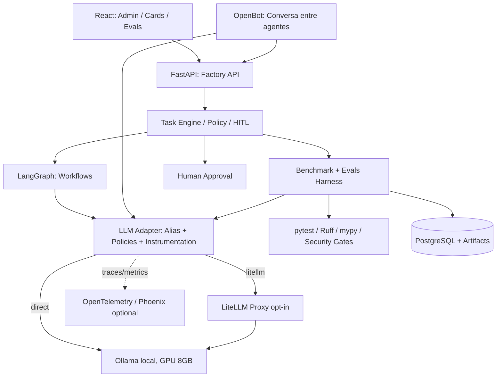

# 08 — SPECIFY + DESIGN + TASKS: LiteLLM Gateway e Benchmark Local de Coding e LLM-as-a-Judge

> **Status:** proposta de implementação / complemento da Agentic Factory Local v2. Não constitui serviço já implementado.  
> **Escopo:** monorepo próprio; Python/FastAPI + React/shadcn/ui; OpenBot para colaboração, LangGraph para workflows; PostgreSQL/Redis, Ollama na RTX 4060 Ti **8 GB VRAM**, 64 GB RAM, observabilidade self-hosted, HITL.  
> **Precedência:** este documento rege **apenas** o módulo LiteLLM/benchmark; não substitui `01-SPECIFY`, `02-DESIGN` e `03-TASKS` para o restante da fábrica.  
> **Decisão:** LiteLLM **opt-in**. Ollama direto continua disponível; nenhum serviço cloud, LangSmith, GitHub Actions ou API paga é obrigatório.  
> **Referências técnicas:** https://docs.litellm.ai/docs/ ; https://docs.litellm.ai/docs/proxy/ ; https://docs.litellm.ai/docs/proxy/logging ; https://docs.litellm.ai/docs/proxy/prometheus ; https://docs.ollama.com/api/ . Conferir sintaxe/configurações na versão fixada antes de implementar.

## 1. Problema, objetivo e não objetivos

A fábrica dispõe de vários agentes (Discovery, Planner, Backend, Frontend, QA, Reviewer) e um Judge. A GPU de 8 GB impede presumir que modelos grandes tenham inferência interativa, especialmente quando agentes são concorrentes. Atualmente seria fácil confundir **qualidade do modelo** com **latência do Ollama**, **troca de modelos na VRAM**, **overhead do proxy**, **contexto diferente** ou **erros de tool calling**. Precisamos comparar alternativas **com medidas reproduzíveis**, roteamento explícito e rollback simples.

**Objetivo:** adicionar opcionalmente LiteLLM Proxy como interface centralizada de modelos Ollama, e um *Benchmark & Eval Harness* Python para medir, por papel, **tarefas aceitas por hora**, **qualidade de código**, **confiabilidade do Judge**, **latência**, **consumo de tokens**, **RAM/VRAM** e **overhead introduzido pelo gateway**. Registrar evidências numéricas e apoiar decisão humana sobre modelos/prompts. **Ganhos de qualidade não são atribuídos ao LiteLLM:** ele roteia requisições; qualidade deriva de modelo, quantização, prompts, contexto e ferramenta.

**Fora do escopo agora:** executar modelos em nuvem, custos de API externa, autoscaling, deploy público, multi-tenant, treinar/fine-tunar pesos, auto-promover prompts, usar Judge como autoridade única para PRs, expor LiteLLM/Ollama à internet, pipelines GitHub Actions. Também não permitir que um agente edite a configuração do gateway ou chaves em execução.

## 2. Requisitos funcionais (EARS) e de segurança

| ID | Especificação / verificação | Prioridade |
|---|---|---|
| LLMG-001 | **Quando** `LLM_GATEWAY_MODE=direct`, todos os agentes/benchmarks deverão conectar-se ao Ollama sem LiteLLM. | P0 |
| LLMG-002 | **Quando** `LLM_GATEWAY_MODE=litellm`, o LLM Adapter deverá resolver aliases `chat`, `coding`, `judge` via LiteLLM, sem mudar contratos OpenBot/LangGraph. | P0 |
| LLMG-003 | O gateway deverá ser restrito à rede interna Docker; não publicar porta em `0.0.0.0` no host. | P0 |
| LLMG-004 | O administrador deverá cadastrar candidatos Ollama com nome, tag, quantização, digest, contexto e papel; sem downloads automáticos. | P0 |
| LLMG-005 | **Se** LiteLLM estiver indisponível, o preflight retornará `exit 2` para o modo proxy e exibirá ação de diagnóstico; fallback para `direct` exigirá mudança explícita de configuração. | P0 |
| LLMG-006 | O harness deverá testar o **mesmo candidato** via Ollama direto e via LiteLLM, em condições equivalentes, para estimar overhead. | P0 |
| LLMG-007 | O harness deverá comparar modelos de coding em fixtures versionadas com os mesmos requisitos, arquivos, ferramentas, contexto e budgets. | P0 |
| LLMG-008 | Um Judge independente deverá avaliar rubricas com evidências e JSON estrito; falha de parsing deverá ser registrada como falha. | P0 |
| LLMG-009 | Os Judges deverão ser calibrados contra exemplos **rotulados por humanos**; accuracy isolada não substitui FPR/FNR e análise de defeitos críticos. | P0 |
| LLMG-010 | Toda execução deverá registrar `run_id`, `task_id`, modelo/digest/quant, rota, versão do prompt, versão do dataset, orçamento, início/fim e artefatos. | P0 |
| LLMG-011 | Scripts deverão produzir **uma linha JSON curta** e códigos de saída `0` PASS, `1` FAIL, `2` INFRA/CONFIG; logs completos persistidos em arquivos. | P0 |
| LLMG-012 | Toda pontuação de código deverá priorizar testes determinísticos; Judge complementa, não substitui pytest, Ruff, mypy, Playwright e segurança. | P0 |
| LLMG-013 | O gateway não poderá efetuar fallback remoto, retry oculto nem alternar modelos durante experimentos controlados. | P0 |
| LLMG-014 | A seleção de modelo/prompt vencedor e sua promoção para produção exigirão aprovação humana, regressão aprovada e rollback definido. | P0 |
| LLMG-015 | Prompts, respostas, logs e traces não poderão conter chaves, `.env`, dados pessoais ou código irrelevante; telemetria minimizada/redigida. | P0 |
| LLMG-016 | Quando o operador abrir a tela Evals, deverá conseguir comparar qualidade, custo computacional, tempo e confiança por modelo e perfil. | P1 |
| LLMG-017 | Quando um agente conversar diretamente no OpenBot, o roteamento de chat deverá continuar funcionando sem desencadear benchmark ou Judge a cada mensagem. | P1 |
| LLMG-018 | Um job programado/manual poderá reavaliar o conjunto de regressão e produzir diferenças contra o baseline aprovado. | P1 |
| LLMG-019 | O preflight atual deverá verificar configuração e credenciais internas do LiteLLM quando habilitado, usando chamadas de leitura/saúde com timeout e sem vazar segredos. | P0 |
| LLMG-020 | A indisponibilidade de Phoenix e do módulo de benchmark não poderá derrubar a operação principal da fábrica. | P1 |
| LLMG-021 | Testes e resultados deverão distinguir `unsupported_tool_call`, `model_failure`, `timeout`, `gateway_error`, `evaluation_error`, `sandbox_failure`. | P0 |
| LLMG-022 | O operador poderá executar benchmarks nos modos `direct`, `proxy` e `compare`, com `--dry-run` que não faz inferência. | P0 |
| LLMG-023 | A fábrica deverá manter no banco apenas metadados/score compactos e artefatos em `.runtime`, com retenção configurável. | P1 |
| LLMG-024 | Toda classificação de vencedor deverá trazer número de casos, variância/intervalo de confiança ou aviso de evidência insuficiente. | P0 |

## 3. Hipóteses de modelos e restrições reais

**Não são rankings comprovados nem promessas de desempenho.** Confirmar tags disponíveis usando `ollama list`/catálogo antes do pull. Começar com no máximo dois modelos físicos instalados e usar a mesma GPU **sequencialmente**. A seleção é dirigida a testes:

| Grupo | Primeiro candidato | Alternativa | Finalidade |
|---|---|---|---|
| Agente conversacional / Discovery | `qwen3:4b` (confirmar tag) | outro 3B–4B disponível | Responsividade, perguntas e esclarecimentos |
| Coding | `qwen2.5-coder:7b` | variante menor ou `qwen3:8b` se couber | Patches Python, TS, testes e migrations |
| Judge textual | `qwen3:8b` | `qwen3:4b`/modelo de família distinta para controle | Rubricas de avaliação e identificação de lacunas |

> **Validade:** variar candidatos por disponibilidade e resultados reais. 8 GB VRAM podem ser insuficientes para alguns contextos de 8K+, mesmo com pesos quantizados. Observar offload e swapping. Juiz e executor da mesma família têm erros correlacionados; fazer calibração humana e eventualmente usar um juiz de outra família. Um modelo menor que não suporte tool calling não entra na rodada de agente com ferramentas, mas pode participar da rodada de edição textual.

Configuração inicial de pesquisa (ajustável após baseline): `num_ctx=4096`, temperatura `0` (ainda não garante determinismo), máximo de saída `1024`, `LLM_MAX_CONCURRENT_REQUESTS=1`, 3 repetições por tarefa/modelo (5 se viável), uma rodada de warm-up por candidato, sem outros modelos competindo pela GPU. Reportar resultados de contextos 4K e 8K **separadamente**.

## 4. Arquitetura e fronteiras



- **LLM Adapter (Factory-owned)**: única abstração própria para `chat`, `coding`, `judge`, `model_id`, timeout, streaming, mensagens, tool-calling e telemetria. Diretamente aponta à API compatível do Ollama ou ao LiteLLM, conforme modo; manter adaptadores distintos quando a compatibilidade diferir. Não pressupor que todo formato Ollama (incluindo estatísticas nativas) sobreviva ao proxy.
- **LiteLLM Proxy**: autenticação local, aliases, padronização de chamadas, métricas e roteamento **explícito**; retries/fallbacks desabilitados em benchmark. Não realiza inferência, não recebe tokens do GitHub, não dá permissão aos agentes.
- **Task Engine/Policy/HITL**: controla permissão, aprovação, relação `task_id`, orçamento e promoção de configuração. O gateway não é fonte de verdade das atividades.
- **Ollama**: roda em máquina host/WSL ou container com GPU devidamente configurada; o hostname `ollama` existe **somente** se estiver no mesmo Compose; se Ollama for host, usar `host.docker.internal` quando resolvido/configurado.
- **OpenBot**: integração pode precisar de configuração de provedor nas Settings do próprio serviço; realizar teste ponta a ponta via proxy, não supor que herde ENV da Factory API.
- **Observabilidade**: capturar headers `x-litellm-call-id` quando presentes, `traceparent`, métricas Ollama nativas no modo direto. Instrumentar manualmente exceções e etapas ausentes. Phoenix opt-in.

## 5. Docker e configuração mínima proposta (não operacional até implementada)

Adicionar serviço sob `infra/compose/litellm.yml` (profile `benchmark` ou `llm-gateway`), com imagem LiteLLM **pinada por digest/versão validada**, sem expor publicamente o proxy. Opcional mapear somente `127.0.0.1:4000:4000` para desenvolvimento; se a API estiver dentro da mesma rede Compose, usar `http://litellm:4000/v1` (verificar endpoints suportados pela versão fixada). As credenciais do gateway ficam **fora do Git**; não confundir `LITELLM_MASTER_KEY` com chaves de APIs remotas.

Exemplo de mapeamento sem fallback (`infra/litellm/config.example.yaml`):

```yaml
model_list:
  - model_name: coding
    litellm_params:
      model: ollama_chat/qwen2.5-coder:7b
      api_base: http://ollama:11434
  - model_name: judge
    litellm_params:
      model: ollama_chat/qwen3:8b
      api_base: http://ollama:11434
  - model_name: chat
    litellm_params:
      model: ollama_chat/qwen3:4b
      api_base: http://ollama:11434
# Em benchmark, não configurar fallbacks / routing implícitos.
```

Nota: ajustar `api_base` para `http://host.docker.internal:11434` quando o Ollama roda no host. Validar a sintaxe das opções de retries/fallbacks da versão pinada, em vez de copiar flags sem confirmação. Métricas OTEL/Prometheus exigem configuração e testes explícitos; sem expor endpoint `/metrics` publicamente.

Acrescentar ao `.env.example` (**NÃO** colocar segredos reais no arquivo versionado):

```dotenv
LLM_GATEWAY_MODE=direct
LITELLM_ENABLED=false
LITELLM_BASE_URL=http://127.0.0.1:4000/v1
LITELLM_CONTAINER_BASE_URL=http://litellm:4000/v1
LITELLM_MASTER_KEY=
LITELLM_MODEL_CHAT=chat
LITELLM_MODEL_CODING=coding
LITELLM_MODEL_JUDGE=judge
LLM_BENCHMARK_ENABLED=false
LLM_BENCHMARK_REPEATS=3
LLM_BENCHMARK_MAX_CONCURRENT_REQUESTS=1
LLM_BENCHMARK_CONTEXT_TOKENS=4096
LLM_BENCHMARK_MAX_OUTPUT_TOKENS=1024
LLM_BENCHMARK_REPORT_DIR=.runtime/benchmarks
LLM_JUDGE_GOLDSET_PATH=evals/goldsets/judge-v1.jsonl
LLM_BENCHMARK_ALLOW_REMOTE=false
```

**Credenciais locais:** `LITELLM_MASTER_KEY` é gerada localmente pelo operador (nunca aqui), armazenada no `.env` não versionado; variável de autenticação enviada ao cliente será lida por backend/worker somente. Confirmar se a configuração LiteLLM requer chave master/DB na versão adotada; evitar DB e virtual keys adicionais se não forem necessários no MVP.

## 6. Desenho do benchmark: modelo executor vs LLM-as-a-Judge

### 6.1 Trilhas independentes

**A — Infraestrutura / gateway:** enviar a mesma carga ao Ollama diretamente e via LiteLLM, com o mesmo modelo, quantização, prompt, sampling, contexto, e limites. Medir `p50`, `p95`, `time_to_first_token` (somente streaming), total, prefill, geração, tokens/s, RAM/VRAM pico, load_duration e taxa de erros. Rodar em ordem alternada ABBA, com warm-up, para reduzir viés de cache; reportar separadamente **cold** e **warm**. Contabilizar overhead do proxy com `proxy_latency - direct_latency`, estimativa pareada, e preferir métricas nativas de proxy quando disponíveis. **Não** comparar qualidade usando condições diferentes só porque passam por gateways distintos.

**B — Qualidade dos executores:** rodar um agente/fixture do cadastro `customer-registry` em clone/worktree descartável, com testes ocultos preservados fora do contexto. Casos sugeridos: correção de CPF, telefone válido/inválido, migration compatível, regressão auth, dependência vulnerável, refatoração de serviço, integração React+API, teste de caso de borda por QA. Cada atividade tem `task_spec`, base commit, `allowed_paths`, asserts, budget, timeout e dificuldade. Capturar diff, quantidades de arquivos alterados, número de tool calls, testes e falhas.

**C — Calibração de Judges:** conjunto inicial sugerido de 30–50 amostras rotuladas por humanos (mínimo 20 antes de comparar), incluindo respostas corretas, incompletas, falsas e perigosas; juízes recebem rubrica versionada, evidências pertinentes e devem responder JSON estrito. Medir concordância com humano, matriz de confusão, precisão e recall de achados reais, falso negativo crítico, consistência entre repetições, taxa de JSON válido, latência e proporção de citações/evidências verificáveis. Não entregar ao Judge apenas a nota do executor; ele avalia artefatos verificáveis.

**D — Comparação de prompts:** para um mesmo agente/modelo, A/B de `prompt_version` com baseline e candidato na **mesma** fixture, repetição e orçamento. Guardar holdout secreto, não otimizar contra o conjunto de avaliação final. A promoção exige HITL.

### 6.2 Formulário de resultados e métricas

| Métrica | Cálculo / fonte | Uso na decisão |
|---|---|---|
| `functional_pass_rate` | tarefas com testes ocultos+integração aprovados / tentativas válidas | qualidade prioritária de coding |
| `first_pass_success` | tarefas aceitas na primeira tentativa / tarefas | retrabalho |
| `accepted_tasks_per_hour` | tarefas aceitas / tempo total wall-clock (h), incluindo reload, queue e retries | custo-benefício local |
| `patch_scope_violations` | alterações fora dos `allowed_paths` | segurança/bloqueio |
| `p50_latency_ms`, `p95_latency_ms` | amostras por modelo/config | tempo de resposta |
| `generation_tokens_per_sec` | tokens de saída / tempo de geração do Ollama quando disponível | eficiência de inferência |
| `gateway_overhead_ms` | diferença pareada proxy vs direto | justificar uso LiteLLM |
| `peak_vram_mb`, `peak_ram_mb` | NVIDIA/OS sampler + timestamps | adequação ao hardware |
| `tool_call_success_rate` | calls executadas corretamente / total | aptidão agêntica |
| `tokens_per_accepted_task` | tokens em todas as tentativas / tarefas aceitas | eficiência de tokens |
| `judge_precision`, `judge_recall` | contra defeitos conhecidos rotulados | capacidade de identificar problemas |
| `judge_false_negative_critical` | defeitos críticos que Judge não detectou | veto de confiabilidade |
| `judge_human_agreement` | decisão do juiz vs rótulo humano | calibração |
| `judge_schema_valid_rate` | JSON válido e aderente ao schema / respostas | confiabilidade operacional |
| `energy_wh` | potência amostrada × duração (estimativa, opcional) | custo elétrico |

**Não equiparar gasto nominal LiteLLM de `$0` a custo zero real.** Para execução local, reportar `CPU/GPU seconds`, energia estimada e tarefas aceitas/hora; preço por token da API não reflete custo do hardware. Guardar valores brutos e versão das fórmulas.

### 6.3 Regras de pontuação e bloqueio

Evitar score único mascarando defeitos. Produzir **gates** binários de validade e três rankings separados:

- `coding_quality`: 60% taxa funcional, 20% first-pass, 10% escopo/estabilidade, 10% qualidade subjetiva **somente com Judge calibrado**; pesos são hipótese inicial, versionados.
- `operational_efficiency`: 40% tarefas aceitas/hora, 25% p95 (invertido e normalizado), 20% tokens/tarefa aceita (invertido), 15% RAM/VRAM e estabilidade (normalizado); não reportar score composto sem publicar denominadores.
- `judge_trust`: ordenar primariamente por falsos negativos críticos, depois precisão/recall, concordância humana, JSON válido e latência. Um juiz que perde defeitos críticos não é promovido, mesmo que rápido.

**Gates de veto:** falha em preflight, shell/policy violation, código fora do escopo, vazamento de segredo, testes funcionais críticos reprovados ou falsa aprovação de defeito crítico. **Nunca** deixar o próprio Judge alterar sua rubrica ou resultado.

### 6.4 Garantias metodológicas

1. Pin de tag **e digest** do modelo, quantização, versão Ollama e LiteLLM, `num_ctx`, temperatura, `seed` quando suportada e limites. Tags mutáveis não bastam.
2. Mesma base de código, mesmas ferramentas e mesmas restrições de permissão, mesma especificação de tarefa.
3. Baseline sem concorrência. Depois, experimento separado com concorrência de 1 e 2 para medir degradação; **não** transformar 2 agentes em 2 modelos ativos compulsoriamente na GPU 8 GB.
4. Repetir execuções, sumarizar mediana e variabilidade. Com poucas amostras, classificar `inconclusive`; não afirmar superioridade estatística.
5. Impedir que os testes ocultos ou gabaritos humanos sejam injetados no contexto do executor/Judge.
6. Não promover automaticamente modelos, prompts ou configurações após benchmark. Guardar parecer, evidências e aprovação.

## 7. Artefatos e contratos

Estrutura adicional proposta:

```text
apps/factory-api/app/llm/adapter.py
apps/factory-api/app/llm/direct_ollama.py
apps/factory-api/app/llm/litellm_proxy.py
packages/benchmark-runner/{runner.py,models.py,metrics.py,reports.py}
packages/eval-engine/{judge.py,rubrics.py,calibration.py}
evals/{fixtures/,goldsets/,rubrics/}
infra/compose/litellm.yml
infra/litellm/config.example.yaml
scripts/{validate_llm_gateway.py,benchmark_models.py,benchmark_judges.py,compare_gateway.py}
tests/{unit/,integration/,smoke/}
.runtime/benchmarks/<run_id>/{summary.json,raw.jsonl,logs/,patches/}
```

**`BenchmarkRun`** no PostgreSQL: `id, dataset_version, mode, status, started_at, finished_at, host_fingerprint, gpu_model, ollama_version, litellm_version, git_sha, config_hash`.  
**`ModelCandidate`**: `model_name, digest, quantization, roles_supported, context_limit, tool_calls_supported, source`.  
**`BenchmarkTrial`**: `run_id, fixture_id, model_candidate_id, prompt_version, seed, repetition, route, trace_id, outcome, error_class, metrics_json, artifact_path`.  
**`JudgeEvaluation`**: `trial_id, judge_model, judge_prompt_version, rubric_version, human_label_ref, decision, cited_evidence_refs, json_valid, critical_miss`.  
**`PromotionDecision`**: `candidate, previous_baseline, diff_report, approver, approved_at, rollback_reference`.

### 7.1 Saída de scripts: uma linha, status 0/1/2

```json
{"check":"llm-gateway-preflight","ok":1,"route":"proxy","models_found":3,"auth_ok":1,"latency_ms":15}
```

```json
{"check":"coding-benchmark","ok":1,"models":2,"trials":18,"accepted":11,"top_model":"qwen2.5-coder:7b","report":".runtime/benchmarks/run-01/summary.json"}
```

```json
{"check":"judge-calibration","ok":0,"schema_valid_rate":1.0,"false_negative_critical":2,"reason":"CRITICAL_MISS","report":".runtime/benchmarks/run-02/summary.json"}
```

**Códigos:** `0` todos os gates aplicáveis aprovados; `1` benchmark/teste válido mas falha de qualidade; `2` serviço/configuração/infra indisponível (inclui modelos ausentes e falha de autenticação). Falhas por tentativa não devem derrubar o lote inteiro silenciosamente; reportar contagem e classificação. `stdout` apenas JSON mínimo; `stderr` sem credenciais e logs completos em `.runtime`.

### 7.2 CLI proposta

```bash
python scripts/validate_env.py --mode local --require core,ollama
python scripts/validate_llm_gateway.py --mode direct
python scripts/validate_llm_gateway.py --mode proxy  # apenas depois de ativar LiteLLM
python scripts/benchmark_models.py --role coding --route direct --dataset evals/fixtures/coding-v1 --repeats 3
python scripts/compare_gateway.py --model qwen2.5-coder:7b --repeats 5 --cold-and-warm
python scripts/benchmark_judges.py --goldset evals/goldsets/judge-v1.jsonl --repeats 3
```

Esses comandos são **contratos a implementar**, não scripts afirmados como já existentes. Primeiro entregar `--dry-run` e depois conectividade real.

## 8. Fases, tarefas atômicas e testes de aceite

### L0 — Pré-requisitos e contrato (LLMG-T01 a T04)

| ID | Executor / dependência | Arquivos e implementação concreta | Evidência / aceite |
|---|---|---|---|
| LLMG-T01 | Tech Lead / — | ADR do gateway opt-in, regras de fallback, não objetivos, inventário de modelos e versão de dependências | ADR aprovado; modo `direct` preservado |
| LLMG-T02 | Infra / T01 | Adicionar `.env.example` (sem segredos), `infra/litellm/config.example.yaml` e Compose opcional sem expor portas ao público; fixar tag/digest em implementação | `docker compose config` válido com profile desligado/ligado |
| LLMG-T03 | QA / T02 | Estender `validate_env.py`, criar `validate_llm_gateway.py`: syntactic/dry-run/live, auth health, aliases e Ollama; categorias HTTP_401, MODEL_MISSING, NETWORK | testes offline + JSON/exit 0/1/2; segredos não logados |
| LLMG-T04 | Backend / T01 | Criar contrato de `LLMAdapter` e duas implementações, com compatibilidade de stream/tool calling testada | fake adapters unitários; modo direto sem LiteLLM |

### L1 — Gateway e métricas (LLMG-T05 a T08)

| ID | Executor / dependência | Arquivos e implementação concreta | Evidência / aceite |
|---|---|---|---|
| LLMG-T05 | Infra / T02,T03 | Subir LiteLLM em profile Compose, configurar aliases `chat/coding/judge`, auth interna, modelo Ollama no host/rede | smoke chat retorna resposta; rota sem publicar gateway externamente |
| LLMG-T06 | Backend / T04,T05 | Integrar OpenBot provider settings e LangGraph via adapter; propagar `task_id`/trace; filas de inferência GPU | smoke com OpenBot e fake LangGraph; 1 chamada de cada vez |
| LLMG-T07 | Observability / T05 | Instrumentar OTEL, requests/retries, uso tokens, headers e métricas de GPU; não capturar raw prompts por default | trace correlacionado, sem segredos; Phoenix opcional |
| LLMG-T08 | QA / T05,T07 | Teste A/B do mesmo modelo direto vs proxy, quente/frio, warm-up, pareamento ABBA, p50/p95 | relatório de overhead; sem conclusão se N insuficiente |

### L2 — Benchmark de agentes codificadores (LLMG-T09 a T12)

| ID | Executor / dependência | Arquivos e implementação concreta | Evidência / aceite |
|---|---|---|---|
| LLMG-T09 | QA+Backend / T04 | Fixtures versionadas customer-registry, issues simuladas, testes ocultos, `allowed_paths`, sandbox descartável | fixture íntegra, casos positivos/negativos, sem vazamento do gabarito |
| LLMG-T10 | Backend / T08,T09 | Runner para seleção de modelo/prompt/contexto, budgets, tries, chamadas, VRAM e tokens; JSONL bruto + síntese | medição 1 modelo × 1 fixture em modo direto e proxy |
| LLMG-T11 | QA / T10 | Integração Ruff, pytest, mypy, Semgrep opcionais com adaptador status/metric; classificar infra vs código | resultados reprodutíveis 0/1/2; artefatos anexados |
| LLMG-T12 | Tech Lead / T10,T11 | Ranking por qualidade vs eficiência, métricas e variabilidade; separar pequenas tarefas e longas | relatório inclui tarefas aceitas/h e tokens por aceite |

### L3 — Judge, calibração e HITL (LLMG-T13 a T17)

| ID | Executor / dependência | Arquivos e implementação concreta | Evidência / aceite |
|---|---|---|---|
| LLMG-T13 | QA+Humano / T09 | Criar goldset rotulado e rubricas por papel com casos de erro intencional e gravidade | 20+ rótulos conferidos, holdout segregado |
| LLMG-T14 | Backend / T04,T13 | Judge runner separado do executor, JSON schema/Pydantic, evidência por trecho/arquivo e retries limitados | invalid JSON contabilizado; não forçar score quando faltam evidências |
| LLMG-T15 | QA / T14 | Precisão, recall, FNR crítico, acordo humano, consistência e latência; comparação entre 2 Judges | relatório com matriz de confusão, exemplos divergentes |
| LLMG-T16 | HITL / T12,T15 | Workflow LangGraph propõe nova versão de prompt/modelo; humano aprova, rejeita ou solicita alterações | prompt ativo não muda sem aprovação e regressão |
| LLMG-T17 | Security / T14,T16 | Testes de prompt injection, vazamento, alteração indevida de gabarito e bypass de policies | tentativa maliciosa bloqueada; resultado persistido |

### L4 — Dashboard e operação incremental (LLMG-T18 a T21)

| ID | Executor / dependência | Arquivos e implementação concreta | Evidência / aceite |
|---|---|---|---|
| LLMG-T18 | Frontend / T12,T15 | Dashboard React com filtros por role/modelo, tab coding/judge, gráficos tempo × qualidade, traces e comparação de prompts | E2E de navegação + estados vazio/erro |
| LLMG-T19 | Backend / T12,T15 | Persistência resumida e retenção dos artefatos, relatórios `.json` e `.md`, exportação CSV opcional | exclusão de artefatos obsoletos sem eliminar auditoria essencial |
| LLMG-T20 | SRE / T05,T18 | Runbook: start/stop, modo direct↔proxy, diagnosticar autenticação, modelo ausente, OOM, latência e rollback | cenário LiteLLM offline não bloqueia `direct` |
| LLMG-T21 | QA / T17,T19,T20 | Aceite E2E: perfis coding e judge, AB proxy/direct, red-team, bloqueio HITL, 8 GB VRAM | relatório final real assinado e parecer humano |

**Dependências especiais:** T06/07 podem evoluir em paralelo após T05. T09 exige que o demo de cadastro exista e tenha fixtures estáveis. T13 depende de anotadores humanos. Dashboard P1, **não** bloquear primeiro benchmark CLI.

## 9. Política de Evals e aprovação (Human-in-the-Loop)

- Agentes OpenBot podem sugerir mudança de modelo, prompts ou tests; não podem editar `.env`, registry de modelos ativos, rubricas, goldset, políticas ou resultados.
- LangGraph faz pausa em transições sensíveis: promover `coding`/`judge` alias de produção, usar modelo remoto, aumentar orçamento acima de limite, alterar prompts de base, publicar PR de código da própria fábrica.
- LLM-as-a-Judge registra **opinião estruturada e evidência**; não pode reclassificar gate determinístico de FAIL para PASS. Resultados de segurança são veto.
- Avaliações humanas não podem ser substituídas por “alta confiança” do juiz; discrepâncias alimentam backlog de prompt improvement.
- Prompts candidatos são comparados A/B em versões imutáveis com mesmo dataset. Antes da promoção, human reviewer inspeciona deltas, regressões e falso negativo crítico.

## 10. Definition of Done e decisão de adotar LiteLLM

**Só considerar LiteLLM justificado** quando o relatório comprovar benefício relevante para múltiplos perfis/modelos (ex.: roteamento, governança, simplicidade operacional ou logs) **sem impacto inaceitável em latência e confiabilidade**. Critérios a decidir após baseline: sobrecarga relativa p95 (proposta: ≤10% em carga warm para tarefas longas), disponibilidade, custo de manutenção, erros adicionais e qualidade idêntica do mesmo modelo sob roteamento controlado. Esse limiar é um ponto de partida, não SLA preexistente.

**DoD mínimo P0:** gateway desligável; todos os scripts com JSON 0/1/2; preflight ativo; um experimento pareado direto/proxy; pelo menos duas opções de executor e juiz testadas com métricas reais (pode ocorrer em etapas); calibração do Judge contra humanos; sem outbound remoto; sem segredos em traces; rollback testado; decisão HITL registrada. Se recursos de hardware impedirem uma rodada, reportar `inconclusive` com o impedimento, não fabricar notas.

## 11. Diretriz curta para a IA implementadora

> Implementar o módulo **LiteLLM Gateway & Local Benchmark** conforme `docs/08-LITELLM-GATEWAY-BENCHMARK-CODING-JUDGE.md` de forma **incremental**, sem substituir OpenBot ou LangGraph, sem habilitar provedores pagos e sem alterar `.env` real. Primeiro L0 (interfaces, preflight e testes offline); depois L1 (LiteLLM e medições direto/proxy); L2 (benchmark com fixtures reais); L3 (Judge, goldset e HITL); L4 (dashboard, runbook). Não declarar benchmark ou modelo vencedor sem medições. Em toda tarefa, imprimir apenas um JSON compacto + exit code e guardar logs extensos fora do contexto do LLM.
